

# BrimDeck - A Dynamic Island for Windows

BrimDeck is a Dynamic Island for Windows 11 that brings your AI coding tool quotas, usage and the music you are playing together at the top of the screen. 
It stays collapsed at the top of the screen and opens only when you need it. 
A native Windows app built with C# and WPF, designed for performance and smoothness.

<a href="#features">Features</a> · <a href="#install">Install</a> · <a href="#quick-start">Quick start</a> · <a href="#privacy">Privacy</a> · <a href="#faq">FAQ</a> · <a href="#contributing">Contributing</a> · <a href="README.zh-CN.md">简体中文</a>

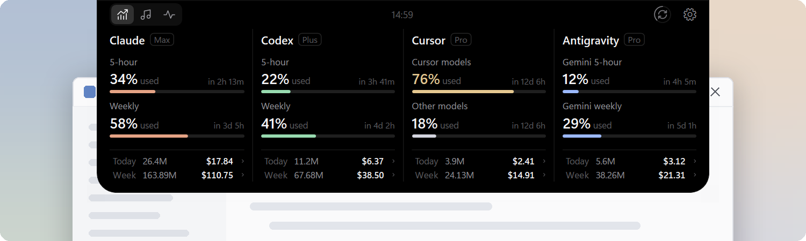

## Why BrimDeck

- **All quotas in one place**: Quotas for Claude, Codex, Cursor, Antigravity and more are shown in a single panel, so you no longer open each website, command line or app to check them.
- **Quota checks made simple**: BrimDeck stays collapsed at the top of the screen. Move the pointer over it to open it, and move away to close it.
- **Media control**: Preview and control the song that is playing inline; the cover, equalizer and lyrics follow the music.
- **System monitor**: CPU, memory, network speed and other readings stay in the notch or capsule, visible at a glance.
- **No interruptions in full screen**: Hides automatically while you play full-screen games or watch full-screen video, so it never opens by accident. Adjustable in settings.
- **Works out of the box**: Detects Claude, Codex, Cursor and other tools already signed in on this PC. No keys to enter and no extra sign-in.
- **Native Windows**: Built on .NET and WPF to deliver smooth animation with low resource use.

## Features

### Collapsed styles

BrimDeck sits at the top center of the screen and comes in three styles: Notch (default), Capsule and Indicator.

<table>
  <tr>
    <td align="center">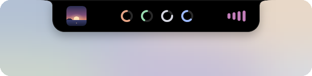 Notch (default)</td>
    <td align="center">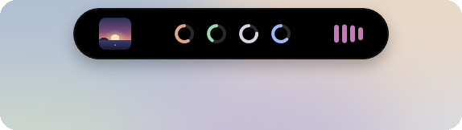 Capsule</td>
    <td align="center"> Indicator</td>
  </tr>
</table>

- Notch and Capsule show the highest quota usage of each tool as a ring, and preview the music that is playing with its cover, an equalizer, and the title or the current lyric line.

  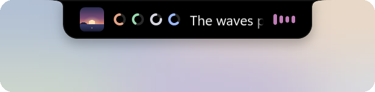

- The notch and capsule can show the time. It sits on the right when shown with the quota rings or music, and is centered when shown alone; its colors can be customized.

  

- When a tool's quota usage rises to the warning (70%) or critical (90%) level, the collapsed view shows a notice for 5 seconds. You can turn this off in settings.

  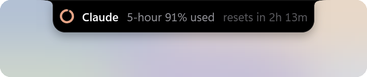

- Notch and Capsule can show system readings next to the quota rings and the music.

  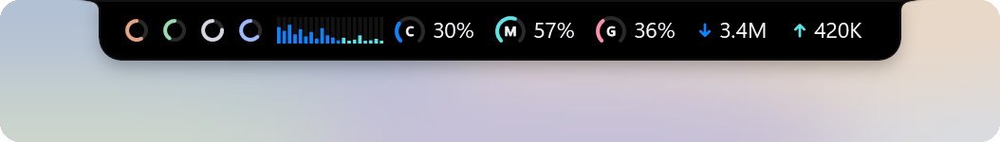

- The size and position of the Notch, Capsule and Indicator can be adjusted in settings.

- By default it turns into the Indicator when a window is maximized, and hides during full-screen games or video so it never opens by accident.

### AI usage

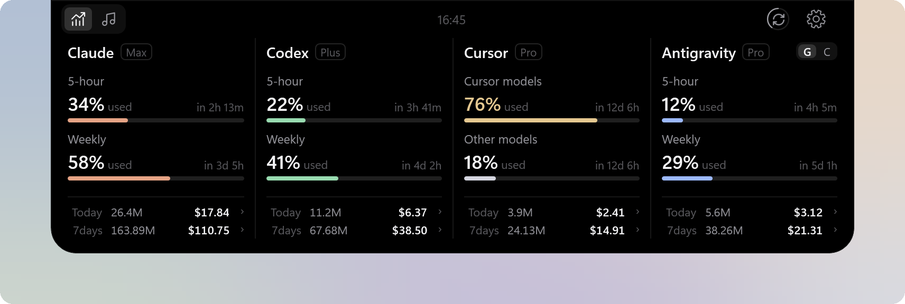

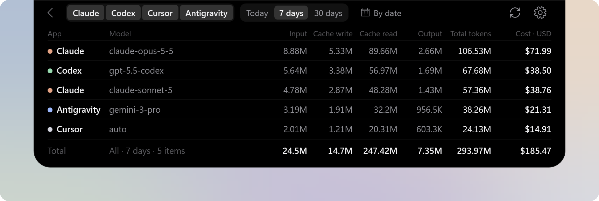

- One column per tool shows the plan, quota usage and reset countdowns, for up to 7 tools at once.
- The bottom of each column totals tokens and estimated cost for today and the last 7 days.
- Token and cost details are available for each model, filtered by tool and date range.

You can choose the quota providers and set the quota and usage source of each column separately. See [Supported tools](docs/en-US/ai-tools.md).

### Music

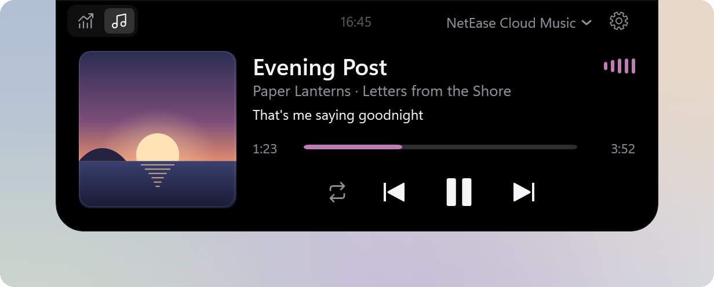

- Shows song information, synced lyrics and playback progress, with playback controls, playback mode switching and seeking in supported players.
- Works with several players at once; switch between them or pin one.

Works with players that use Windows media controls, with extra support for some players. See [Supported players](docs/en-US/music-players.md).

### System monitor

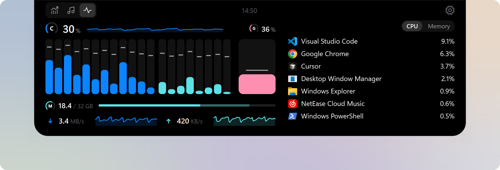

- Shows CPU, GPU and memory usage and network speed in real time, along with the usage of each core. With more than one graphics card, the discrete one shows by default; click the large GPU reading to show the next card, or choose one under Settings › System monitor › GPU.
- Lists the busiest apps by CPU or memory; click an app for its details.
- Shows the space in use on each physical drive, one line per drive, with a segment per letter for a drive split into several; only internal drives are listed, not USB sticks, SD cards, external or network drives.
- Shows CPU, GPU and solid-state drive temperatures (you can turn them off in settings; the CPU, GPU and drive readings in the notch or capsule can show them too). No administrator rights or drivers are needed; sensors that cannot be read are left out. The GPU temperature is the one Task Manager shows; the CPU temperature comes from the firmware's ACPI thermal zones, may be the board's rather than the CPU's own, and many PCs do not provide it.
- Shows the whole machine's power draw in watts, with the last minute as a curve and the peak since the page was opened; the tooltip adds the mean and what the figure is made of (Settings › System monitor › Show power; the notch or capsule can show it too). The figure comes from the PC's own power meter if it has one, else from the battery's discharge while a laptop runs on battery, else it is an estimate (the tooltip says so) from the processor's power and an NVIDIA graphics card's board power, which leaves out the display, storage, fans and power-supply loss. It is read only while the page or the notch or capsule shows it, and the NVIDIA card is asked only while it is working. No administrator rights or drivers are needed.
- On a laptop or tablet, also shows this PC's own battery: the charge as a battery drawn in the theme's style (with a plug in it while the PC is plugged in), followed by the time left or to full where Windows gives one; it sits at the right end of the power line. Its tooltip has the rate in watts, the Windows power mode, Battery saver and the battery's health (full-charge capacity against design capacity). The notch or capsule can show the charge too (Settings › System monitor › the readings table). At 25% or less the charge takes the warning color and at 15% or less the critical color while the PC runs on battery; a normal charge, charging or Battery saver never takes either color. PCs without a battery show nothing of it.
- Colors follow the panel theme by default; several preset color schemes are offered, and you can make your own.

The page is adapted from [ftop](https://github.com/Nongfsq/ftop) by Nongfsq (MIT License), a system monitor for macOS.

### Panel themes

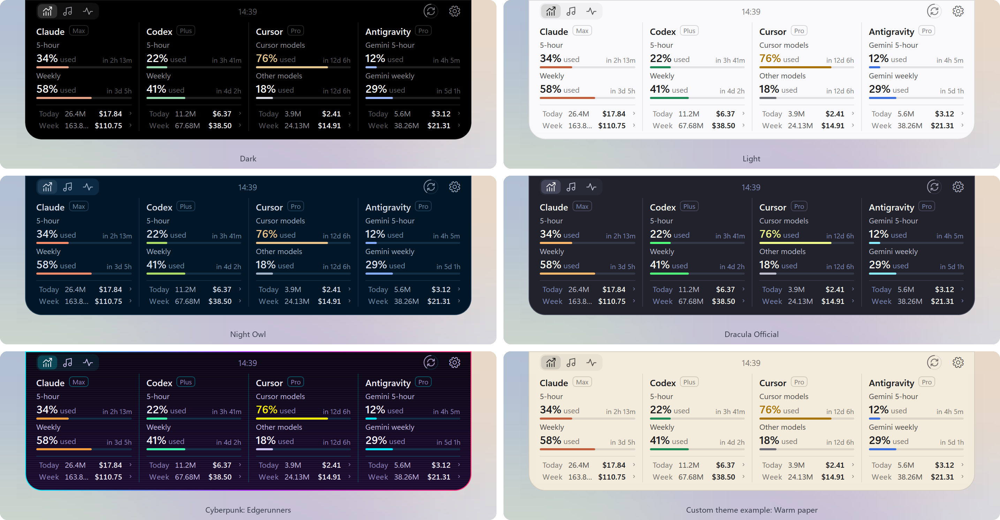

- Built-in themes include Dark, Light, One Dark Pro, GitHub Dark, GitHub Light, Dracula, Night Owl and Cyberpunk: Edgerunners.
- On the Panel theme page in settings, you can change the background, foreground, accent and other colors and save them as a custom theme, or write a theme file by following the [theme guide](docs/en-US/themes.md).

## Install

Requires Windows 11 (x64). Windows 10 (version 2004 or later) has limited support.

1. Download one of these files from [Releases](https://github.com/MoFeng2223/BrimDeck/releases/latest):
   - Installer: `BrimDeck-<version>-Setup.exe`. Run it and follow the steps.
   - Portable: `BrimDeck-<version>-Portable-x64.zip`. Extract it and run `BrimDeck.exe` in the `BrimDeck` folder.
2. If Windows shows "Windows protected your PC", select "More info", then "Run anyway".

Both versions update from within the app, and both keep settings and data in `%LOCALAPPDATA%\BrimDeck`. The app offers releases only; turn on "Receive beta updates" on the About page of settings to be offered betas too. When the portable version is in a folder that needs administrator rights to change, such as `C:\Program Files`, the update asks for administrator approval. To stop using the portable version, turn off starting with Windows in settings if it is on, then delete its folder; to remove settings and data as well, also delete `%LOCALAPPDATA%\BrimDeck`.

## Quick start

1. After you install and start BrimDeck, the panel appears at the top center of the primary display, showing Claude and Codex by default.
2. Move the pointer over the panel to open it; move away or press Esc to close it.
3. Select the settings button at the top right of the open panel to add tools or change settings. You can also right-click the open panel, double-click the tray icon, or right-click the tray icon.

## Uninstall

Installer: uninstall BrimDeck from Apps in Windows Settings. Portable: turn off starting with Windows in settings if it is on, then delete its folder.

## Privacy

- Reads only the sign-in state and usage records that apps already keep, and never changes, renews or ends their sign-ins.
- Sign-in tokens are used only in memory and never written to disk; API keys you enter are stored on this PC, encrypted by Windows.
- Goes online only to read quotas and usage, update model prices, fetch lyrics and covers, and check for updates. Conversations are never uploaded, and no usage data is collected.

For the files BrimDeck reads and the addresses it connects to, see [Data and privacy](docs/en-US/privacy.md).

## FAQ

**A tool shows "Not connected" or "Waiting for update". What should I do?**
Make sure the tool is signed in on this PC; for example, Antigravity needs its desktop app running for its quota to be read. When BrimDeck cannot read the data, it shows the actual status and never makes up numbers.

**Is the cost shown what I actually pay?**
No. Costs come from the amounts reported by each service or from public model prices, and are meant to show how much you use. Your actual subscription charges are on each provider's bill.

## Contributing

You are welcome to report problems, suggest features or ask for more tools and players in [Issues](https://github.com/MoFeng2223/BrimDeck/issues), and to contribute through pull requests.

- Do not open pull requests against `main`:
  - Open new features and general fixes against the `dev` branch.
  - When a version enters testing, it gets a `release/<version>` branch (for example `release/1.3.0`). Open fixes for that version against that branch. It accepts fixes only, not new features.
- Upcoming work is listed in the [BrimDeck roadmap](https://github.com/MoFeng2223/BrimDeck/discussions/57). Suggest features under that post, and reply there when you want to take on one of its items. Other topics are welcome in [Discussions](https://github.com/MoFeng2223/BrimDeck/discussions).

## License

BrimDeck is licensed under the [Apache License 2.0](LICENSE). Third-party licenses are listed in [ThirdPartyNotices.txt](src/BrimDeck/ThirdPartyNotices.txt).

The system monitor page is adapted from [ftop](https://github.com/Nongfsq/ftop) by Nongfsq, licensed under the MIT License; thanks to its author.
