

# BrimDeck - A Dynamic Island for Windows

BrimDeck is a Dynamic Island for Windows 11 that brings your AI coding tool quotas and usage, the music you are playing, system readings and wireless device batteries together at the top of the screen, with a clipboard history and a file transfer. 
It stays collapsed at the top of the screen and opens only when you need it. 
A native Windows app built with C# and WPF, designed for performance and smoothness.

<a href="#features">Features</a> · <a href="#install">Install</a> · <a href="#quick-start">Quick start</a> · <a href="#privacy">Privacy</a> · <a href="#faq">FAQ</a> · <a href="#contributing">Contributing</a> · <a href="README.zh-CN.md">简体中文</a>

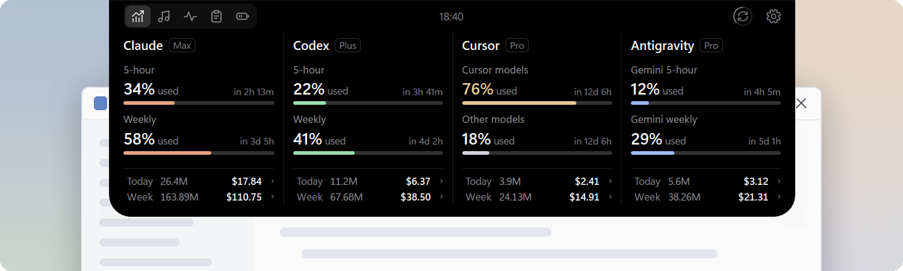

## Why BrimDeck

- **All quotas in one place**: Quotas for Claude, Codex, Cursor, Antigravity and more are shown in a single panel, so you no longer open each website, command line or app to check them.
- **Quota checks made simple**: BrimDeck stays collapsed at the top of the screen. Move the pointer over it to open it, and move away to close it.
- **Media control**: Preview and control the song that is playing inline; the cover, equalizer and lyrics follow the music.
- **System monitor**: CPU, memory, network speed and other readings stay in the notch or capsule, visible at a glance.
- **Device batteries**: The batteries of your wireless mouse, keyboard, headset and controller in one place, changing color when one runs low.
- **Clipboard and file transfer**: Paste text and pictures you copied earlier with one click; drop files on the panel to hold them, then drag them out or paste them when needed.
- **No interruptions in full screen**: Hides automatically while you play full-screen games or watch full-screen video, so it never opens by accident. Adjustable in settings.
- **Works out of the box**: Detects Claude, Codex, Cursor and other tools already signed in on this PC. No keys to enter and no extra sign-in.
- **Native Windows**: Built on .NET and WPF to deliver smooth animation with low resource use.

## Features

### Collapsed styles

BrimDeck sits at the top center of the screen and comes in three styles: Notch (default), Capsule and Indicator.

<table>
  <tr>
    <td align="center">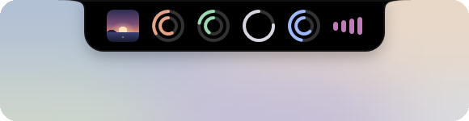 Notch (default)</td>
    <td align="center">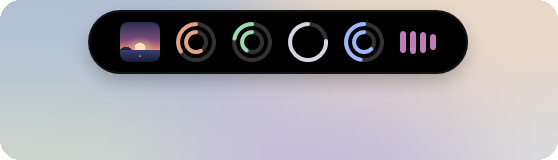 Capsule</td>
    <td align="center">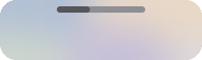 Indicator</td>
  </tr>
</table>

- Notch and Capsule show each tool's quota usage as rings. Choose one ring per tool (the default), or nested rings: up to three concentric rings per tool, each showing the quota you choose. The rings and the panel's bars can show what is used or what is left, and the first letter of the tool's display name can be shown inside its ring (off by default). They also preview the music that is playing with its cover, an equalizer, and the title or the current lyric line.

  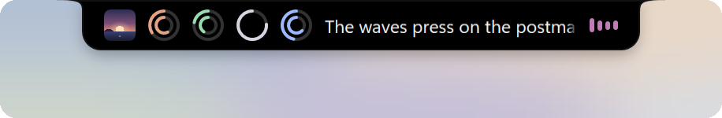

- The notch and capsule can show the time. It sits on the right when shown with the quota rings or music, and is centered when shown alone; its colors can be customized.

  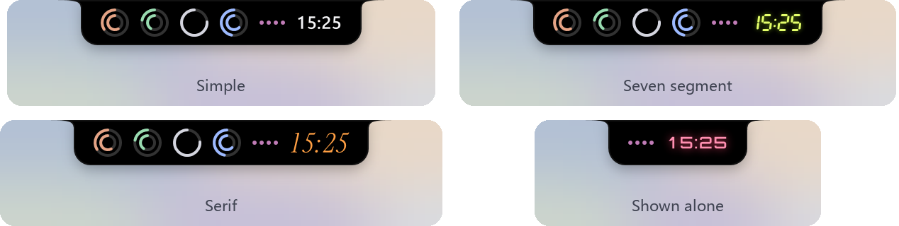

- When a tool's quota usage rises to the warning (70%) or critical (90%) level, the collapsed view shows a notice for 5 seconds. You can turn this off in settings.

  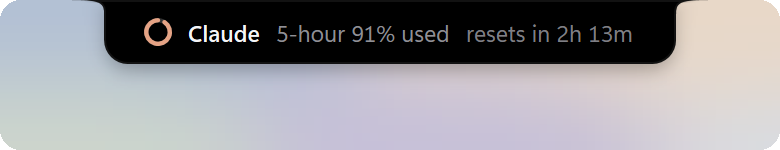

- Notch and Capsule can show system readings next to the quota rings and the music.

  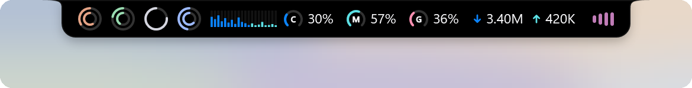

- Notch and Capsule can show the batteries of wireless devices and the number of files in the file transfer.

  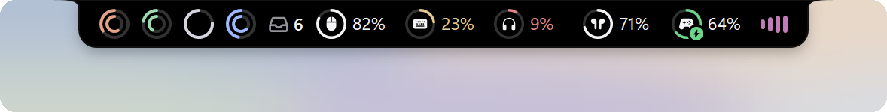

- The size and position of the Notch, Capsule and Indicator can be adjusted in settings. The Notch and Indicator can hang from the top, bottom, left or right edge of the screen, and all three styles can sit inside the taskbar.

- By default it turns into the Indicator when a window is maximized, and hides during full-screen games or video so it never opens by accident.

- It stays above other windows by default. It can instead be covered by other windows like any window, coming to the front when it expands (Settings › General › Window behavior).

### AI usage

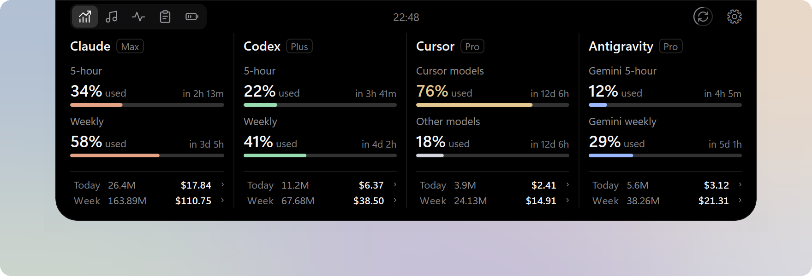

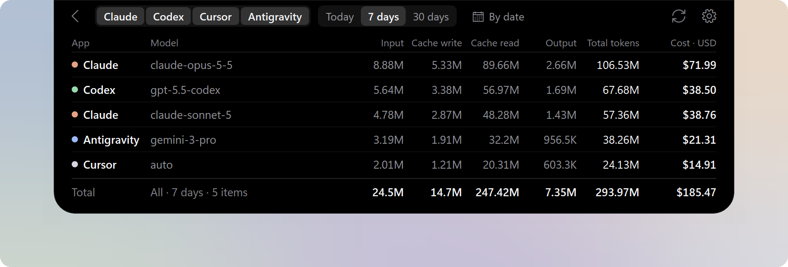

- One column per tool shows the plan, quota usage and reset countdowns, for up to 7 tools at once.
- The bottom of each column totals tokens and estimated cost for today and the last 7 days.
- Token and cost details are available for each model, filtered by tool and date range.

You can choose the quota providers and set the quota and usage source of each column separately. See [Supported tools](docs/en-US/ai-tools.md).

### Music

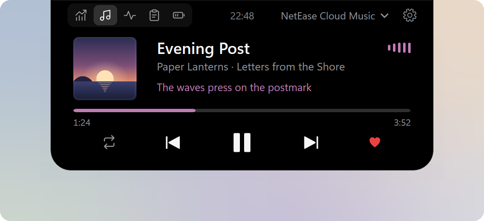

- Shows song information, synced lyrics and playback progress, with playback controls, playback mode switching and seeking in supported players.
- Works with several players at once; switch between them or pin one, and ignore apps you do not want shown.
- The equalizer can flow with the sound or show its pitch from low to high as a spectrum; its length and colors can be adjusted.
- Drag with the mouse or swipe with two fingers on the music page to change the song, switch players or adjust the volume.

Works with players that use Windows media controls, with extra support for NetEase Cloud Music, QQ Music, Apple Music and KuGou Music. See [Supported players](docs/en-US/music-players.md).

### System monitor

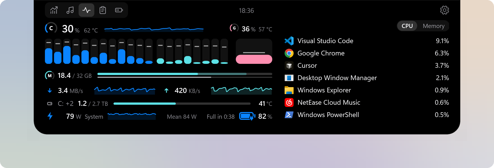

- Shows CPU, GPU and memory usage and network speed in real time, along with the usage of each core; with more than one graphics card, you choose which one shows.
- Lists the busiest apps by CPU or memory; click an app for its details.
- Shows the space in use on internal drives, the whole machine's power draw, and the battery of a laptop or tablet.
- Optionally shows CPU, GPU and solid-state drive temperatures, and the frame rate of the program in front.
- Colors follow the panel theme by default; several preset color schemes are offered, and you can make your own.

For where each reading comes from and its limits, see [System monitor readings](docs/en-US/system-monitor.md). PCs whose CPU temperature or power cannot be read can turn on [enhanced sensors](docs/en-US/enhanced-sensors.md).

The page is adapted from [ftop](https://github.com/Nongfsq/ftop) by Nongfsq (MIT License), a system monitor for macOS.

### Device batteries

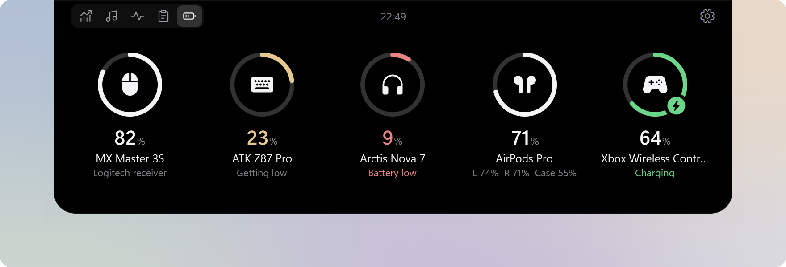

- Shows the battery of the connected wireless mice, keyboards, headsets, controllers and pens; AirPods show each bud and the case.
- A battery that is getting low takes the warning color and a low one the critical color; a charging one shows a bolt. Both thresholds can be adjusted.
- Rename devices, change their order and colors, and choose separately whether each shows on the page and when collapsed.
- Batteries are only read: nothing on the devices or in Windows is changed.

For the supported connections, brands and models, see [Supported devices](docs/en-US/devices.md).

### Clipboard and file transfer

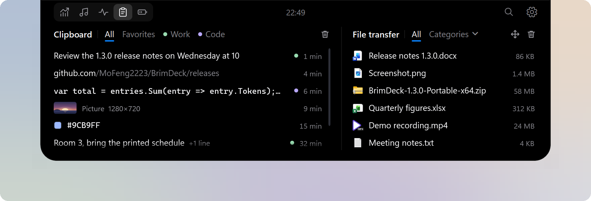

- **Clipboard**: Keeps the text and pictures you copy; click an entry to paste it into the window you are working in. Links, code and color values each show in their own style.
- The history is stored encrypted on this PC and cleared when BrimDeck exits; what is in Favorites or in a category set to be kept stays. You can choose apps that are not recorded.
- **File transfer**: Drag files onto the notch, the capsule or the panel to hold them, then click to paste them into the current window or drag them to where you need them. Only each file's location is kept, never a copy.
- Both columns have categories with rules for what goes in by itself, and can be searched together.

For how to use it and its settings, see [Clipboard and file transfer](docs/en-US/clipboard.md).

### Panel themes

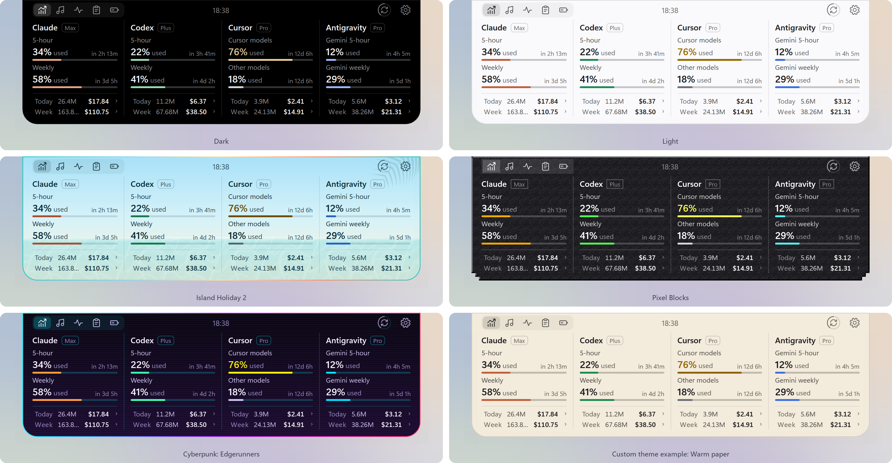

- Built-in themes include Dark, Light, One Dark Pro, GitHub Dark, GitHub Light, Dracula, Night Owl, Island Holiday, Pixel Blocks and Cyberpunk: Edgerunners; the Island Holiday themes change between a day and a night look by the local time.
- On the Panel theme page in settings, you can change the background, foreground, accent and other colors and save them as a custom theme, or write a theme file by following the [theme guide](docs/en-US/themes.md).
- The interface font can be any font installed on the PC, and the panel's background transparency can be adjusted (Settings › General › Appearance and language).

### More settings

- **Shortcuts**: Global shortcuts can expand or hide the panel, open a given page, switch the collapsed style, and move or resize the panel (Settings › Shortcuts).
- **Expand on**: Hover or click (Settings › General › Hover and animation).
- **Mouse pass-through**: Hovering no longer opens the panel and clicks go through it to the window beneath; only shortcuts open it. This suits gaming (Settings › General › Compatibility).
- **Scale**: The panel can be drawn at 100% or 150% for high-resolution displays.
- **Resource use**: Saver, Balanced and Smooth (Settings › General › Startup and resources).

## Install

Requires Windows 11 (x64). Windows 10 (version 2004 or later) has limited support.

1. Download one of these files from [Releases](https://github.com/MoFeng2223/BrimDeck/releases/latest):
   - Installer: `BrimDeck-<version>-Setup.exe`. Run it and follow the steps.
   - Portable: `BrimDeck-<version>-Portable-x64.zip`. Extract it and run `BrimDeck.exe` in the `BrimDeck` folder.
2. If Windows shows "Windows protected your PC", select "More info", then "Run anyway".

Both versions update from within the app, and both keep settings and data in `%LOCALAPPDATA%\BrimDeck`.

- The app offers releases only; turn on "Receive beta updates" on the About BrimDeck page of settings to be offered betas too.
- When the portable version is in a folder that needs administrator rights to change, such as `C:\Program Files`, the update asks for administrator approval.

## Quick start

1. After you install and start BrimDeck, the panel appears at the top center of the primary display, showing Claude and Codex by default.
2. Move the pointer over the panel to open it; move away or press Esc to close it.
3. Use the page switch at the top left of the open panel to move between AI usage, music, the system monitor, the clipboard and file transfer, and device batteries; pages you do not need can be turned off or reordered under Settings › Expanded view.
4. Select the settings button at the top right of the open panel to add tools or change settings. You can also right-click the open panel, double-click the tray icon, or right-click the tray icon.

## Uninstall

- Installer: uninstall BrimDeck from Apps in Windows Settings.
- Portable: turn off starting with Windows in settings if it is on, then delete its folder.

To remove settings and data as well, also delete `%LOCALAPPDATA%\BrimDeck`. If you turned on enhanced sensors, uninstalling the installed version removes the sensor service too; with the portable version, turn it off under Settings › Enhanced sensors first.

## Privacy

- Reads only the sign-in state and usage records that apps already keep, and never changes, renews or ends their sign-ins.
- Sign-in tokens are used only in memory and never written to disk; API keys you enter are stored on this PC, encrypted by Windows.
- The clipboard history and the file transfer's list are stored only on this PC, encrypted by Windows, and never uploaded.
- Goes online only to read quotas and usage, update model prices, fetch lyrics and covers, and check for updates. Conversations are never uploaded, and no usage data is collected.

For the files BrimDeck reads and the addresses it connects to, see [Data and privacy](docs/en-US/privacy.md).

## FAQ

**A tool shows "Not connected" or "Waiting for update". What should I do?**
Make sure the tool is signed in on this PC; for example, Antigravity needs its desktop app running for its quota to be read. When BrimDeck cannot read the data, it shows the actual status and never makes up numbers.

**Is the cost shown what I actually pay?**
No. Costs come from the amounts reported by each service or from public model prices, and are meant to show how much you use. Your actual subscription charges are on each provider's bill.

**Why does the system monitor show no CPU temperature or power?**
On many PCs Windows does not provide either. Turn on enhanced sensors under Settings › Enhanced sensors, or run HWiNFO or LibreHardwareMonitor alongside. See [Enhanced sensors](docs/en-US/enhanced-sensors.md).

**My mouse, keyboard or headset shows no battery. Why?**
The device has to be connected and be one of the connections or models listed in [Supported devices](docs/en-US/devices.md). For a device that is not listed, you are welcome to report its model in [Issues](https://github.com/MoFeng2223/BrimDeck/issues).

## Contributing

You are welcome to report problems, suggest features or ask for more tools, players and devices in [Issues](https://github.com/MoFeng2223/BrimDeck/issues), and to contribute through pull requests.

- Do not open pull requests against `main`:
  - Open new features and general fixes against the `dev` branch.
  - When a version enters testing, it gets a `release/<version>` branch (for example `release/1.3.0`). Open fixes for that version against that branch. It accepts fixes only, not new features.
- Upcoming work is listed in the [BrimDeck roadmap](https://github.com/MoFeng2223/BrimDeck/discussions/57). Suggest features under that post, and reply there when you want to take on one of its items. Other topics are welcome in [Discussions](https://github.com/MoFeng2223/BrimDeck/discussions).

## License

BrimDeck is licensed under the [Apache License 2.0](LICENSE). Third-party licenses are listed in [ThirdPartyNotices.txt](src/BrimDeck/ThirdPartyNotices.txt).

- The system monitor page is adapted from [ftop](https://github.com/Nongfsq/ftop) by Nongfsq, licensed under the MIT License; thanks to its author.
- Parts of the device battery protocols are ported from several open-source projects, listed in [Supported devices](docs/en-US/devices.md#acknowledgements); thanks to their authors.
