

# BrimDeck - Windows 灵动岛

BrimDeck 是 Windows 11 上的灵动岛，在屏幕顶部集中显示 AI 编程工具的额度与用量、正在播放的音乐、系统读数和无线设备电量，并提供剪贴板记录与文件中转。 
平时收起在屏幕顶部，只在需要时展开。 
Windows 原生应用，使用 C# 与 WPF 开发，注重性能与流畅度。

<a href="#功能">功能</a> · <a href="#安装">安装</a> · <a href="#快速开始">快速开始</a> · <a href="#隐私">隐私</a> · <a href="#常见问题">常见问题</a> · <a href="#参与开发">参与开发</a> · <a href="README.md">English</a>

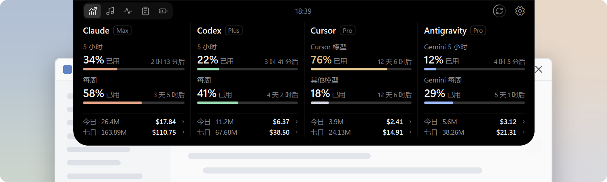

## 为什么选择 BrimDeck

- **额度集中显示**：Claude、Codex、Cursor、Antigravity 等工具的额度集中在一个面板上，不必逐个打开网页、命令行或应用查看。
- **简化额度查询操作**：平时收起在屏幕顶部，鼠标移上去即展开，移开即收起。
- **媒体控制**：内联预览与控制正在播放的歌曲，封面、律动条与歌词随音乐变化。
- **系统监控**：CPU、内存、网速等读数常驻在刘海或胶囊中，一眼即可看到。
- **设备电量**：无线鼠标、键盘、耳机和手柄的电量集中显示，电量低时变色提示。
- **剪贴板与文件中转**：复制过的文字和图片单击即可再次粘贴；文件拖到面板上暂存，需要时再拖出或粘贴。
- **全屏免打扰**：全屏玩游戏或看视频时自动隐藏，避免误触展开；可在设置中调整。
- **开箱即用**：自动识别本机已登录的 Claude、Codex、Cursor 等工具，无需填写密钥或重新登录。
- **Windows 原生**：基于 .NET 与 WPF 构建，以较低的资源占用提供流畅的动画体验。

## 功能

### 收起形态

BrimDeck 平时位于屏幕顶部中央，提供刘海（默认）、胶囊和指示条三种样式。

<table>
  <tr>
    <td align="center">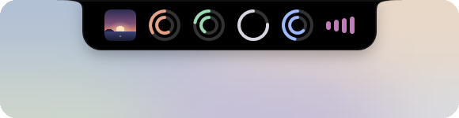 刘海（默认）</td>
    <td align="center">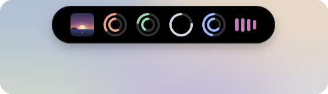 胶囊</td>
    <td align="center"> 指示条</td>
  </tr>
</table>

- 刘海与胶囊通过配额环显示各工具的配额使用率。配额环可以选择单环（默认）或多环：多环时每个工具最多显示三个同心环，每个环显示哪一项额度可以自行选择；配额环和展开面板的进度条可以显示已用额度或剩余额度；环内可以显示工具显示名称的首字母（默认关闭）。还支持音乐预览，可显示封面、律动条、歌名或当前歌词。

  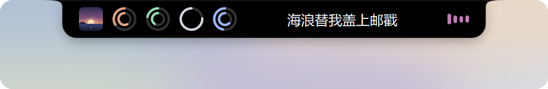

- 刘海与胶囊可以显示时间，与配额环或音乐一起显示时位于右侧，单独显示时居中；可以自定义配色。

  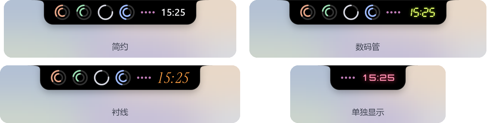

- 某个工具的配额使用率升到预警（70%）或告警（90%）时，收起形态会显示提醒 5 秒；可在设置中关闭。

  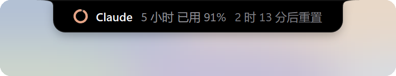

- 刘海与胶囊可以显示系统读数，与配额环、音乐并排显示。

  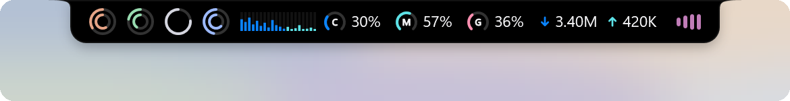

- 刘海与胶囊可以显示无线设备的电量，以及文件中转中的文件数量。

  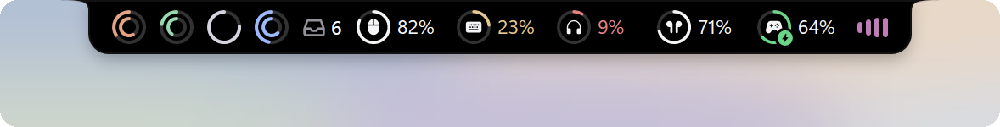

- 刘海、胶囊和指示条的尺寸与位置可在设置中调整；刘海和指示条可以贴靠屏幕的顶部、底部、左侧或右侧，三种样式都可以放在任务栏内。

- 窗口最大化时默认切换为指示条，全屏游戏或视频播放时默认隐藏，避免误触展开。

- 默认显示在其他窗口上方；也可以改为像普通窗口一样被其他窗口遮挡，展开时再显示在最前面（设置 › 常规 › 窗口行为）。

### AI 用量

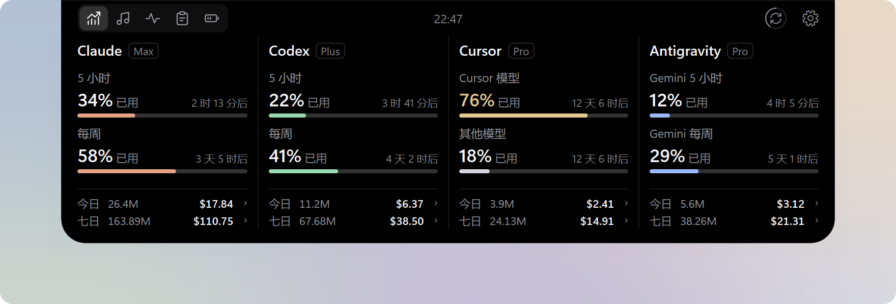

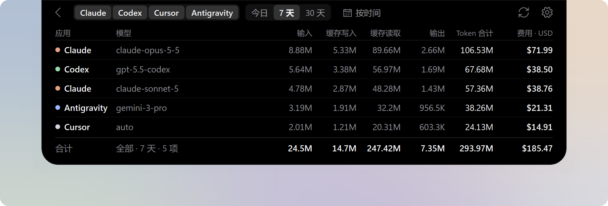

- 按工具分列展示套餐、配额使用率与重置倒计时，最多同时显示 7 个工具。
- 每列底部汇总今日和最近 7 天的 Token 用量与费用估算。
- 可查看各模型的用量与费用明细，支持按工具和日期范围统计。

可自定义配额提供商，并分别设置各列的配额与用量统计来源，详见[支持的工具](docs/zh-CN/ai-tools.md)。

### 音乐

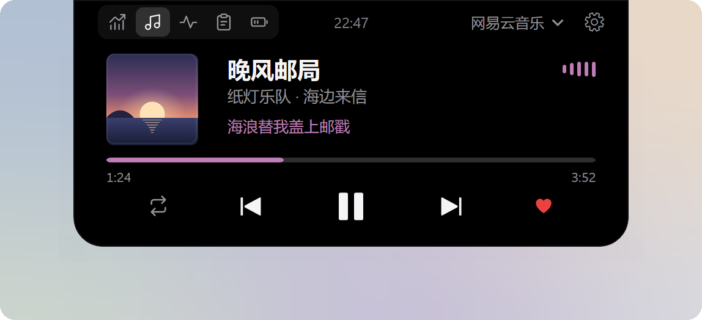

- 显示歌曲信息、同步歌词与播放进度，支持播放控制、播放模式切换，以及受支持播放器的进度调节。
- 支持同时接入多个播放器，可手动切换或固定显示其中一个，也可以忽略不想显示的应用。
- 律动条可以随声音流动，也可以按音高从低到高显示频谱；长度与颜色可以调整。
- 在音乐页上拖动鼠标或用触控板双指滑动，可以切换歌曲、切换播放器或调节音量。

支持接入 Windows 系统媒体控制的播放器，并对网易云音乐、QQ 音乐、Apple Music 和酷狗音乐做了专门适配，详见[播放器支持](docs/zh-CN/music-players.md)。

### 系统监控

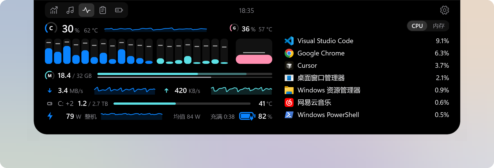

- 实时显示 CPU、GPU、内存的占用和网络速度，以及每个核心的使用率；有多块显卡时可以选择显示哪一块。
- 按 CPU 或内存列出占用最高的应用，点击应用可查看详情。
- 显示内置硬盘的已用空间、整机功耗，以及笔记本和平板的电池电量。
- 可选显示 CPU、GPU 和固态硬盘的温度，以及前台程序的帧率。
- 配色默认跟随面板主题，也提供多种预设配色，并支持自定义。

各项读数的来源与限制，详见[系统监控的读数](docs/zh-CN/system-monitor.md)。读不到 CPU 温度或功耗的电脑，可以启用[增强传感器](docs/zh-CN/enhanced-sensors.md)。

本页参考并改编自 Nongfsq 的 macOS 系统监控 [ftop](https://github.com/Nongfsq/ftop)（MIT 许可证）。

### 设备电量

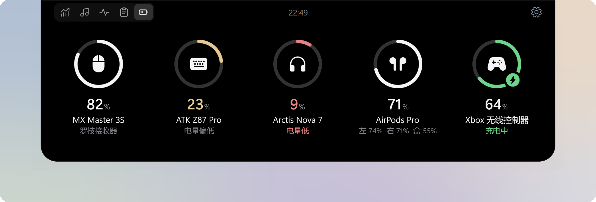

- 显示已连接的无线鼠标、键盘、耳机、手柄和触控笔的电量；AirPods 分别显示左右耳与充电盒。
- 电量偏低和电量低时分别用预警色和告警色显示，充电时显示闪电标记；两个阈值可以调整。
- 可以为设备改名、调整顺序和颜色，并分别选择是否在展开页和收起时显示。
- 只读取电量，不会改动设备或系统设置。

支持的连接方式、品牌与型号，详见[设备电量支持](docs/zh-CN/devices.md)。

### 剪贴板与文件中转

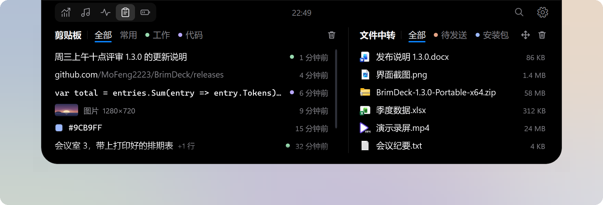

- **剪贴板**：记录复制过的文字和图片，单击即可粘贴到正在使用的窗口；链接、代码和颜色值按各自的样式显示。
- 记录加密保存在本机，退出 BrimDeck 时清除；放入“常用”或一直保留的分类的内容不会清除。可以指定不记录的应用。
- **文件中转**：把文件拖到刘海、胶囊或面板上即可暂存，之后单击粘贴到当前窗口，或拖到需要的位置。只记录文件的位置，不复制文件。
- 两栏都可以建立分类并设置自动归类的规则，也可以一起搜索。

操作方法与设置，详见[剪贴板与文件中转](docs/zh-CN/clipboard.md)。

### 面板主题

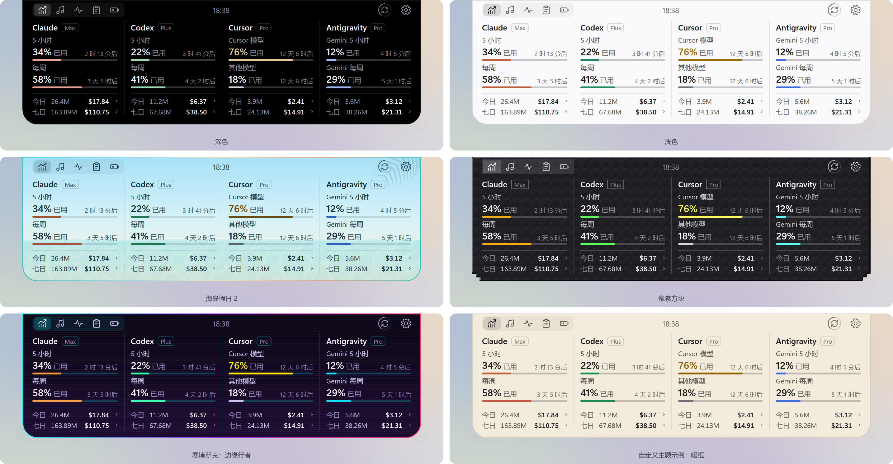

- 内置深色、浅色、One Dark Pro、GitHub Dark、GitHub Light、Dracula、Night Owl、海岛假日、像素方块、赛博朋克：边缘行者等主题；海岛假日主题按本地时间在白天和夜间外观之间切换。
- 可以在设置的“面板主题”页修改背景、前景、强调色等颜色，并保存为自定义主题；也可以按[主题制作指南](docs/zh-CN/themes.md)编写主题文件。
- 界面字体可以换用系统中已安装的字体，面板的背景透明度也可以调整（设置 › 常规 › 外观与语言）。

### 更多设置

- **快捷键**：展开或隐藏面板、打开指定页面、切换收起样式、移动位置与调整大小等，都可以设置全局快捷键（设置 › 快捷键）。
- **展开方式**：可选悬停展开或点击展开（设置 › 常规 › 悬停与动画）。
- **鼠标穿透模式**：开启后悬停不再展开面板，鼠标点击会穿过面板，只能用快捷键展开，适合玩游戏时使用（设置 › 常规 › 兼容性）。
- **缩放**：面板可按 100% 或 150% 显示，适配高分辨率屏幕。
- **资源占用**：提供省资源、平衡、流畅三档（设置 › 常规 › 启动与资源占用）。

## 安装

需要 Windows 11（x64）。对 Windows 10（2004 及以上版本）提供有限支持。

1. 从 [Releases](https://github.com/MoFeng2223/BrimDeck/releases/latest) 下载以下任一文件：
   - 安装版：`BrimDeck-<版本>-Setup.exe`，运行后按提示安装。
   - 免安装版：`BrimDeck-<版本>-Portable-x64.zip`，解压后运行 `BrimDeck` 文件夹中的 `BrimDeck.exe`。
2. 如出现“Windows 已保护你的电脑”提示，点击“更多信息”→“仍要运行”。

两种版本都可以在应用内更新，设置和数据都保存在 `%LOCALAPPDATA%\BrimDeck`。

- 应用内更新默认只提示正式版；在设置的“关于 BrimDeck”页开启“接收测试版更新”后，也会提示测试版。
- 免安装版放在需要管理员权限才能修改的文件夹（例如 `C:\Program Files`）中时，更新会请求管理员确认。

## 快速开始

1. 安装并启动 BrimDeck 后，面板会出现在主显示器顶部中央，默认显示 Claude 和 Codex。
2. 将鼠标移到面板上即可展开，移开鼠标或按 Esc 收起。
3. 点击展开面板左上角的页面切换按钮，在 AI 用量、音乐、系统监控、剪贴板与文件中转、设备电量之间切换；不需要的页面可以在“设置 › 展开外观”中关闭或调整顺序。
4. 点击展开面板右上角的设置按钮，即可添加工具或调整设置；也可在展开的面板上点击右键，或双击系统托盘图标、通过托盘图标的右键菜单进入设置。

## 卸载

- 安装版：前往 Windows 设置中的“应用”卸载。
- 免安装版：先在设置中关闭开机自启动（如已开启），再删除它的文件夹。

如需同时删除设置和数据，再删除 `%LOCALAPPDATA%\BrimDeck`。启用过增强传感器的，卸载安装版时会一并删除传感器服务；免安装版请先在“设置 › 增强传感器”中停用。

## 隐私

- 仅读取应用已有的登录状态与用量记录，不会修改、续期或注销它们的登录。
- 读取的登录令牌仅在内存中使用，不写入磁盘；手动填写的 API 密钥使用 Windows 的加密功能保存在本机。
- 剪贴板记录与文件中转的列表只保存在本机，使用 Windows 的加密功能加密，不会上传。
- 仅在获取配额与用量、同步模型单价、获取歌词与封面、检查更新时联网，不会上传会话内容，也不会收集使用数据。

读取了哪些文件、会连接哪些地址，详见[数据与隐私](docs/zh-CN/privacy.md)。

## 常见问题

**某个工具显示"未连接"或"等待更新"怎么办？**
请确认该工具已在这台电脑上登录；例如 Antigravity 读取配额时需要桌面版正在运行。BrimDeck 读取不到数据时，只显示实际状态，不会显示虚假的数值。

**显示的费用是我实际支付的金额吗？**
不是。费用按接口金额或公开的模型单价计算，适合用来了解用量高低；订阅套餐的实际扣费以各服务商的账单为准。

**系统监控为什么没有 CPU 温度或功耗？**
很多电脑的 Windows 不提供这两项数据。可以在“设置 › 增强传感器”中启用增强传感器，或同时运行 HWiNFO、LibreHardwareMonitor，详见[增强传感器](docs/zh-CN/enhanced-sensors.md)。

**我的鼠标、键盘或耳机没有显示电量？**
设备需要处于连接状态，并且属于[设备电量支持](docs/zh-CN/devices.md)中列出的连接方式或型号。没有列出的设备，欢迎在 [Issues](https://github.com/MoFeng2223/BrimDeck/issues) 中反馈型号。

## 参与开发

欢迎通过 [Issues](https://github.com/MoFeng2223/BrimDeck/issues) 反馈问题、提出功能建议，或申请适配更多工具、播放器与设备，也欢迎提交 Pull Request 参与开发。

- Pull Request 不要直接合入 `main`：
  - 新功能和一般修复以 `dev` 分支为目标。
  - 某个版本进入测试阶段后，会有对应的 `release/<版本>` 分支（例如 `release/1.3.0`）。针对这个版本的问题修复以该分支为目标；该分支只接受问题修复，不接受新功能。
- 后续规划见 [BrimDeck 路线图](https://github.com/MoFeng2223/BrimDeck/discussions/57)。功能建议可以在帖子下讨论，想认领其中某项功能时，也可以直接在帖子下留言。其他话题可以在 [Discussions](https://github.com/MoFeng2223/BrimDeck/discussions) 中讨论。

## 许可证

BrimDeck 采用 [Apache License 2.0](LICENSE)。第三方组件的许可证见 [ThirdPartyNotices.txt](src/BrimDeck/ThirdPartyNotices.txt)。

- 系统监控页参考并改编自 Nongfsq 的 [ftop](https://github.com/Nongfsq/ftop)，ftop 采用 MIT 许可证，感谢原作者。
- 设备电量的部分协议移植自多个开源项目，名单见[设备电量支持](docs/zh-CN/devices.md#致谢)，感谢各位作者。
