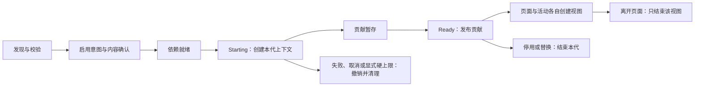

# BrimDeck 模组平台规范

状态：实验平台，当前契约 1.6。本文同时记录**现行实现**与**下一版核心契约验收要求**，两部分明确分开。清单中的 `apiVersion: 1` 目前不能视为已经冻结的 1.x 兼容承诺。

本文与[开发指南](../docs/zh-CN/modules/contributing.md)、[API 参考](../docs/zh-CN/modules/api.md)组成三篇作者主文档；必要界面、生命周期、数据与错误规则均在其中。独立 SDK 含编译引用、检查器和由文档生成的完整模板，开发者不需要阅读宿主源码。UI、宿主规则和配方文章为可选深入材料。

文档入口：[开发与贡献指南](../docs/zh-CN/modules/contributing.md)、[API 参考](../docs/zh-CN/modules/api.md)、[用户使用说明](../docs/zh-CN/modules.md)、[升级记录与 C01–C34 验收映射](../docs/zh-CN/modules/platform-upgrade.md)。

目标是让独立作者通过公开接口完成制作、安装、启停、页面、活动、组件、设置、诊断和版本升级。普通业务页面的内部修改不得成为其他模组的直接依赖；公共 SDK 的变化必须经过兼容性审查。

## 1. 术语与边界

| 名称 | 定义 |
| --- | --- |
| 模组 | 有唯一 ID、版本、入口和激活生命周期的独立程序集包 |
| 组件 | 模组内部可单独启用和排序的功能单元，不等于另一个模组 |
| 贡献 | 模组向宿主登记的一项页面、活动、设置、组件或未来命令 |
| 激活代 | 同一模组一次启用产生的实例身份；再次启用必须是新的一代 |
| 视图实例 | 某个显示器／呈现位置的一次挂载，不拥有整个模组会话 |
| 能力 | 宿主在某个版本和环境下提供的公开接口 |
| 权限 | 通过公开接口执行某类操作所需的授权条件；不是进程安全隔离 |
| 用户选择 | 保存的组件、页面或绑定目标；与眼下能够呈现的条目分别管理 |

宿主拥有窗口、显示器、岛外壳、主导航、通知调度、输入路由和公共主题。模组拥有自身业务状态和被分配区域内的内容。通用 SDK 不返回 `App`、主窗口、内部 store 或某个业务页面对象。

WPF 视图与宿主同进程。普通异常、取消令牌和程序集加载上下文不能隔离死循环、原生崩溃或任意文件访问。进程级可靠性要求需要独立工作进程及通信协议，不得把当前实现宣传成这种隔离。

## 2. 现行清单与安装

每个模组位于实际应用数据目录的 `mods/<目录名>/`。身份取自清单，目录名不决定身份。当前要求清单直接位于该目录内，不自动穿透额外目录层。

```json
{
  "apiVersion": 1,
  "apiMinor": 6,
  "capabilities": ["ui.pages"],
  "optionalCapabilities": [],
  "permissions": [],
  "id": "example-module",
  "name": "示例模组",
  "version": "1.0.0",
  "description": "描述模组的实际用途。",
  "descriptionEn": "Describe the module's actual purpose.",
  "author": "Example author",
  "assembly": "Example.Module.dll",
  "entryType": "Example.Module.Entry",
  "dependencies": []
}
```

| 字段 | 当前规则 |
| --- | --- |
| `apiVersion` / `apiMinor` | 当前 1.6；省略 minor 按 0；未来 minor 拒绝；既有同步与 1.1 数据接口保持兼容 |
| `requires` | `contractMinor` 与必需 `capabilities` 在执行入口前校验 |
| `capabilities` / `optionalCapabilities` | 必需能力缺失则阻止启动；可选能力先通过 host.info 检查 |
| `permissions` | 本体读取与通知接口须声明对应权限；不等于进程隔离 |
| `id` | 最长 80 字符；首字符为小写字母或数字，其余可有连字符；`builtin-` 留给宿主 |
| `name` | 非空名称，供模组管理显示 |
| `version` | `.NET Version` 可解析；建议三段数字；当前不支持 SemVer 预发布标签 |
| `description` / `descriptionEn` / `author` | 可选展示信息，不影响权限或信任 |
| `assembly` | 模组根目录内的 DLL 文件名，不能包含目录跳转 |
| `entryType` | 实现 `IModule` 的完整类型名，提供公开无参构造函数 |
| `dependencies` | ID、`minimumVersion`，可选 `maximumVersionExclusive`（不含上界）；没有可选依赖语义 |

扫描只读取元数据，不执行模组入口。损坏清单、重复 ID、入口 DLL 缺失与不兼容 API 作为独立发现错误记录。运行时与检查器共同限制 2000 个文件、64 MiB、6000 个目录条目和 64 层深度，清单最多 1 MiB；拒绝链接文件、目录及链接的上层路径。清单与 requires／dependencies 对象的同名字段不区分大小写，重复项拒绝。

同 ID 的多份模组全部标记为冲突，不选择其中一个执行；其他无冲突模组继续发现。安装更新时覆盖明确的原始目录，避免保留多个同 ID 副本。

通用随附包安装器先验证与暂存，再交换目录；仅在宿主安装记录与现有目录摘要一致时更新。用户修改过的文件、同 ID 外来包和停用意图均保留。它不是第三方 ZIP 包管理器；当前没有 ZIP 安装、回退命令、签名认证或市场。根目录的这份 `README.md` 不会被当作模组。

## 3. 现行启用、依赖与加载

计时器已迁为 `mods/timers` 完整外部参考模组。主程序分发目录 `mods/` 中的随附包由通用安装器首次安装到应用数据目录，首次安装登记默认启用和内容摘要；普通外来模组仍默认关闭。随附模组也走相同的发现、清单校验、内容摘要、加载上下文和公共服务，没有内置专用工厂或 UI 友元权限。模组系统总开关关闭时不激活模组，已运行的模组会释放资源。

外部模组启用与当前内容摘要绑定。文件变化后原摘要失效，刷新并重新启用才会执行新内容。模组详情显示接口权限，开关动作确认当前内容摘要和清单；没有独立原生确认窗口或签名认证，不展示「已审核」等不存在的认证状态。

加载器对完整目录计算摘要，并建立对应的不可变加载副本。相同内容复用副本，私有 DLL 随本版本解析；公共 SDK 程序集使用宿主实例。`AssemblyLoadContext.Unload()` 发出的是回收请求，仍被任务、静态事件或视图引用的程序集不会立即从内存消失。

依赖先启动，未启用、缺失、版本不足、循环或激活失败阻断有关的依赖方，健康模组继续。不会暗中启用用户关闭的依赖。未变化的模组在普通刷新时保留实例；变更项及相关依赖方才需要重建。

共享 SDK 不能作为模组私有依赖重复打包。直接引用 `BrimDeck` 桌面程序集会被拒绝。静态检查器核对随包私有依赖和已知 minor 要求，但不能完整证明所有运行分支、反射与历史二进制兼容。

## 4. 现行生命周期与贡献



当前状态为 `Disabled`、`Starting`、`Ready`、`Failed`、`DependencyFailed`、`Waiting`；Waiting 追加为 5，保留旧数值。每次激活分配 Generation，慢启动由 Slow 独立表示，不与失败混淆。尚无独立的授权、恢复模式和停止中状态模型。

激活期间登记的贡献、上下文订阅与定时器一起暂存，成功后生效，失败时回滚；不撤销模组自行创建的外部副作用。1.3 起默认五秒只标记慢启动，继续等待，晚完成照常提交。有限硬取消上限仅在宿主显式配置 StartTimeout 时启用。同步代码仍不能被超时强制打断。

主窗口先显示，再异步发现外部模组。运行时只在更新依赖图时串行，等待激活不会持有该锁；无关模组独立启动，配置变更及时撤销有关实例，未变化的启动实例复用。依赖等待绑定确切激活代，停用或替换依赖会同时撤销有关依赖方。清理依赖方后再清理依赖项，旧实例的完成、诊断和释放不会覆盖新实例。目录发现仅在模组系统开启时发起。

注册 ID 由宿主加上所属模组前缀。当前重复检查按贡献 CLR 类型和完整 ID 进行；同一模组可以在不同贡献类型中使用相同局部 ID。旧句柄不能移除另一代的同 ID 条目。

公开贡献白名单为页面、持续活动、组件与设置；未知 CLR 类型在登记时拒绝。minor 1 清单须声明对应 UI 能力，minor 0 兼容旧贡献声明。服务只通过公开接口按能力、权限和激活代绑定；计时器不再需要宿主偏好桥。

模组与视图均提供取消和资源归属。清理后进先出，可重复调用；清理一个资源出错不阻断其他资源。结束后才到达的清理登记会立即执行。停用期间已开始的存储写入要完成，上一代结束后不得覆盖新实例的数据。

## 5. 现行 UI、设置与输入

视图必须按宿主给的区域排版，独立显示实例独立创建控件。计时会话与业务状态留在模组级。打开音乐、监控或其他页面只卸载相应视图，不得结束计时会话。

外壳统一负责展开收起、形状、位置、临时通知覆盖和恢复。活动外壳同时呈现一个活动，优先显式选择的活跃 ID，否则使用首个活跃项。`ShowActivity` 按本模组完整 ID 路由，不提供跨模组抢占协议。

结构化布局 `ModuleViewport` 分开传递 DIP 尺寸、设备／内容缩放、留白与圆角。旧第三参数统一为内容缩放。`Owner` 是局部视图容器；视图导航受所属模组和视图生命周期约束。用户选择的页面 ID 与暂时展示的回退页面分别保留。

1.4 的 `ModulePage.Async` 和可选 `IModuleAsyncActivity` 支持异步挂载。宿主在工厂开始前建立本次视图的资源与激活代归属，加载时显示静态提示；完成后规范化并应用最新布局、刷新状态，再启动视图计时器并交接内容。离开、停用或重载取消该视图，迟到结果清理，旧挂载错误不影响新实例。同一视图或已挂入其他容器的根元素不能被重复占用。所有正常视图创建和释放都在其 UI 调度线程进行。

1.6 设置支持数字、布尔、选项、文本与颜色，扩展步长、分组、说明和占位符。宿主验证字段并隔离非法项，作者负责业务校验、默认值、保存和重置。导航使用可选 `IModuleSettingsNavigation` 显式放置、排序和设置图标，多个组件共用设置只显示一次。尚未提供统一 schema 值存储、密钥字段和通用快捷键字段。

`ModuleViewContext.IsVisible` 和 `OnVisibilityChanged` 表达宿主实际呈现，`EveryVisible` 在隐藏时停止显示用定时器。旧 `Every` 保持挂载生命周期语义；业务不随显示隐藏暂停。配置诊断归当前激活代、按来源与代码去重，不计入运行错误。规则及限制见[宿主规则](../docs/zh-CN/modules/host-rules.md)。

输入法服务及其「仅通知／接管切换」继续由原服务负责。当前没有向模组开放安装全局键盘钩子、注册任意热键或批量注销宿主快捷键的公开能力。

## 6. 现行数据与性能

普通 JSON 位于 `modules-data/<id>/<key>.json`；每文件限制 1 MiB，写入使用临时文件替换。`ReadResult<T>` 区分缺失、有效值与损坏；旧读取方法遇到损坏抛错。没有模组总配额、跨键事务或统一迁移服务，作者不得将损坏当成默认值自动回写。

本体只读接口提供用量、媒体与系统监控的不可变快照，保留缺失和过期状态，不提供账号凭据、账户详情字典、来源路径或可变服务实例。系统和媒体订阅复用本体采样需求，停用后取消。`IModuleNotifications` 通过宿主的限流队列显示短时提醒，遵循岛的显隐与动画规则，结束后恢复持续活动。详细限制以 [API 参考](../docs/zh-CN/modules/api.md#9-本体数据与岛内提醒)为准。

契约 1.2 使用 `ModuleApi.Catalog` 统一能力 ID、种类、名称、引入版本、必要权限、环境、激活归属及公开契约名。清单校验、宿主适配器校验、设置权限名称和生成文档共同读取该目录；具体业务定义的验证器仍归属对应适配器。SDK 已知能力和本机实际可用能力分开，后者只包含实际绑定项及内在服务，不因目录有条目就自动开放。

`modules-cache/<id>/<digest>/` 是程序集加载器缓存，不是对插件开放的通用资产缓存。宿主详情提供实际数据／缓存字节数与清理动作；只删除未使用的副本，活跃加载上下文受保护，待清理记录在下一次正常启动／刷新重试。清空缓存保留业务数据。

卸载确认后先停止该模组及依赖方，完成清理回调，再移除启用／批准记录并处理安装包、业务数据及缓存。宿主以唯一 token 隔离旧目录，先持久化转移归属再删除；重试不触碰新安装同 ID 的包与数据。各目录分别尝试，缓存锁定不能阻止业务数据清理；失败项保留并显示待清理，不宣称已经完成。随附包抑制记录持久化，只有明确恢复才重新自动安装。

维护状态位于应用数据的 `module-files.json`，旧文件暂存于 `.module-trash/<token>/`，均由宿主管理。路径限制在相应应用数据根内，拒绝链接与越界；损坏的维护记录禁止破坏性操作，不默默重置。扫描时仅对登记过且实际缺失的安装目录判定手动删除，仍存在但损坏的包或扫描失败不触发清理。停用仍保留数据，卸载才删除数据。

排队卸载时记录目录的卷、文件标识与创建时间，而不是只凭同名路径重试。原来不存在的目录不归旧任务所有；同名目录后来被替换则保留新内容。写入维护状态失败时，内存的阶段、队列与抑制记录一起回退，未持久化归属转移前不删除暂存文件。撤销启用／批准的设置写入每次重试都必须重新确认落盘，即使内存已经修改过。

旧版待处理记录若没有足够的源目录身份，只清理已明确转入本任务暂存目录的内容，保留不能确认归属的当前目录并提示重新确认卸载。模组总开关关闭时仍可刷新重试维护，恢复模式则不自动清理。操作正忙时明确拒绝后续请求，不把未执行的请求报告为成功。

设置页显示启动耗时、最近五秒平均回调用时、最长回调、调用数、至少 16 ms 的慢调用和错误总数。累计值覆盖当前应用运行；嵌套调用归属按独占时间计算。统计不包含模组自主创建的后台工作，也不是独立 CPU／内存占用。

计量在宿主调用时进行，没有额外后台采样循环和逐调用历史。界面每秒原位更新，离开模组页或最小化后停止界面刷新。错误明细最多保留 200 条，错误总数单独累计。

## 7. 契约来源与版本纪律

1.5 对齐“注册表增加内容、事件总线接入行为、服务调用能力”的扩展形状。`IModulePlatform` 提供三个入口，旧入口保留；注册句柄带命名空间 ID，事件支持稳定优先级与可取消打开钩子。组件顺序、图标、开关与设置导航通过通用契约呈现，计时器自身保存参数与会话。

仓库源码规范目录为 `mods/<功能名>/`，每个可安装模组有一个清单和项目；私有领域库、帮助库归入该模组子目录。构建输出通过 `build/ModulePackage.targets` 生成 `package/<manifest.id>/`，只分发入口、私有依赖和清单，不包含共享 SDK。源码与运行时目录用途分开：`mods/<id>` 是安装文件，`modules-data/<id>` 是业务数据，`modules-cache/<id>/<digest>` 是加载副本。

作者的契约来源是 [API 参考](../docs/zh-CN/modules/api.md)中的生成签名与调用语义。宿主维护者负责从指定类型生成并检查签名；作者不需要反查 Contracts、ModuleViews 或加载器实现来推断行为。独立 SDK 使用 reference assembly，共享运行实现由宿主提供。

每个公开成员还必须有明确语义。C# 的 `public`、默认程序集版本号和清单 API 整数不能替代语义承诺。给现有接口添加必须实现的成员、改变 DTO 构造函数参数、替换返回类型，可能破坏第三方源码或二进制；应检查旧二进制，而不只重新编译当前示例。

下一版必须分别管理：清单格式版本、平台契约 major／minor、宿主应用版本、模组版本、数据 schema 版本和依赖版本。不能用一个 `Version` 字符串代替所有兼容判断。

### 7.1 作者交付验收：现行功能

以下检查与后面的平台规划分开。作者只验证自身实际使用的功能，在发布记录中写明宿主版本、契约、已执行结果与待人工项目。

| 范围 | 作者必须确认 |
| --- | --- |
| 独立工程 | 仅依赖 SDK 和自己的库；无宿主 ProjectReference；按指南在仓库外构建 |
| 包结构 | 清单直接在单个包目录；ID 与工程 ModuleId 一致；入口为公开、非抽象、非泛型、公开无参的 IModule；私有依赖齐全 |
| 声明 | 最低 minor 覆盖所用成员；所需贡献／服务能力、权限完整；可选能力不可用时有降级 |
| 检查 | 对最终包运行静态检查；严格模式无错误／警告；静态通过不等于 UI、原生代码或安全验收 |
| 安装／更新 | 首次默认关闭；启用才执行；文件变化需重新批准；不保留两个同 ID；更新不删除业务数据 |
| 生命周期 | 激活不等自己的暂存事件／定时器；快速启停、失败回滚、页面重建后无旧任务或事件残留 |
| 视图 | 深浅主题、尺寸、缩放、多屏；独立控件共享业务；固定数字宽度；隐藏只停显示任务 |
| 设置与组件 | 五类字段验证、写入与重置；关闭组件的页面／活动策略正确；设置位置与显隐符合声明 |
| 活动与通知 | 完成序号只在真正完成时变；通知覆盖后恢复；业务不随显示暂停；限流、过期、周期去重正确 |
| 持久化 | Missing/Value/Corrupt 分开；无默认覆盖损坏数据；重启恢复、旧 schema 迁移与写失败反馈 |
| 恢复 | 测试宿主 --no-modules 能单次跳过，原偏好保留，管理页可关闭问题项 |

### 7.2 目录、检查命令和报告

源码工程、独立开发包、分发包和用户数据不是同一个目录：

| 目录 | 用途 |
| --- | --- |
| SDK ref/ | 编译引用；禁止装入模组运行目录 |
| SDK templates/ | 可直接复制的三个独立工程，全部来自开发指南代码块 |
| 工程构建 package/id/ | 可安装成品；仅自己的 DLL、私有依赖、清单及必要资源 |
| 应用数据 mods/id/ | 实际安装位置，通过设置按钮打开确定 |
| 应用数据 modules-data/id/ | 业务数据，与安装包分开；更新包不清除此目录 |
| 应用数据 modules-cache/id/digest/ | 宿主管理的加载副本，不直接修改或当作业务缓存 |

统一打包目标当前只收集输出根目录 DLL、deps.json、module.json，并排除共享宿主程序集；子目录或额外资产需作者明确放入成品并检查。没有公开资源根目录 API，不能依赖工作目录；固定资源可嵌入自己的程序集。开发包的可选仓库参考实现不属于独立模板，独立开发以 templates 和三篇主文档为准。

```powershell
dotnet '<SDK>/tools/checker/BrimDeck.ModuleCheck.dll' '<package/id>' --json --warnings-as-errors
```

0=当前策略接受，1=错误或严格模式警告，2=命令用法错误。JSON Passed 为无静态错误，Accepted 为最终策略结果。需要依赖图时加 `--modules-root '<实际 mods 目录>'`；没有该参数时不声称依赖图已验证。

检查器只读清单与 PE 元数据，不加载／激活模组，不执行构造、初始化器、视图、设置 getter 或业务存储。它核对清单、包结构、入口可解析性、私有依赖、共享 DLL、桌面引用及已知 minor 要求；类型使用线索提示能力／权限，不推断完整运行语义。原生导入、初始化器、不能解析的继承等是需继续审查的报告，不是安全证明。

| 常见报告码 | 修复 |
| --- | --- |
| desktop-reference-denied / shared-assembly-bundled | 移除主程序引用／随包 SDK，改用公开接口与统一打包 |
| private-dependency-missing | 带齐自己的依赖 DLL |
| entry-type-missing / invalid-entry-type | 修正完整类型名、公开性、无参构造与 IModule 实现 |
| entry-contract-unverified | 静态继承链未证实；进一步检查，不能当已验证 |
| sdk-minor-too-low | 声明覆盖已用新成员的最低 minor |
| sdk-capability-not-declared / sdk-permission-not-declared | 核对实际调用并补声明 |
| dependency-context-required | 传实际 mods 目录检查相关依赖版本与循环 |
| native-import / module-initializer-present | 审查原生／初始化行为，检查器没有执行它们 |
| package-changed | 停止修改包后重试 |

### 7.3 启动恢复：现行行为

候选模组代码执行前，宿主写入启动记录；首屏完成、启动／配置等待结束并观察到 UI 心跳后清除。五秒慢提示不等于成功或失败。异常退出留下记录后，下次在执行模组前询问是否本次跳过，默认跳过。也可用 `BrimDeck.exe --no-modules` 主动跳过一次。

跳过保留总开关、启用意图、批准及随附包记录，不自动更新随附包。管理页可关闭已启用项，刷新不能绕过本次限制，重新启用需要正常重启。无法写入恢复记录时本次不运行模组并说明数据目录问题。正常响应退出清除记录。恢复覆盖启动／重载阶段，尚无运行期无响应看门狗，不提供进程隔离。

启动与忽略记录各最多读取 64 KiB：启动记录超限时进入「记录不可读」恢复路径，忽略记录超限不能掩盖有效的上次启动记录，也不会中断本体启动。包扫描、签名摘要、内部引用与复制共用目录限制；创建安装输出或加载缓存前先拒绝链接目标，随附包源目录与目标目录不得重叠。签名渠道由宿主信任的密钥决定，包内渠道不一致返回 `channel-mismatch`，不能自行从 beta 改成正式认证。

## 8. 下一版核心契约验收要求

本节供平台维护者规划和验收；开发者使用前面的现行契约即可，不需要实现本节目标才能发布模组。

1.6 宿主已补[启动恢复与静态检查器](../docs/zh-CN/modules/checker.md)：启动记录先于模组代码，恢复可单次跳过而保留偏好；静态检查只读清单和 PE 元数据，不执行模组。它不等于行为探测、签名审核或完整设置 schema，以下验收项仍按各自范围核对。

以下为 BrimDeck 自己的目标规则，**尚未全部实现**。在验收通过并公布冻结版本前，不能把目标接口当作现行 API。具体类型命名可以演进，下面的行为约束不得在实现时省略。

此前已修复七项具体缺口：未知贡献拒绝、公开接口与权限隔离、minor／必需能力校验、依赖兼容上界、宿主事件发布限制、激活前订阅／定时器暂存、结构化存储读取。另已修复局部 Owner、展开尺寸语义和活动 ID 路由，并新增本体读取与通知 API。下面 C01–C34 是更完整的平台目标，不等于本轮已全部验收。

后续已完成 C03 的目录统一：宿主校验绑定的能力种类、CLR 契约及程序集、权限与唯一性；桌面初始化要求目录适配完整，缺项在模组执行前失败；文档生成器的 `--check` 同时检测签名与能力表漂移。完整历史二进制版本矩阵、命令和密钥仍未完成。

1.5 已把三个计时迁为普通 DLL，补齐注册句柄、公共 UI 控件、通用组件排序与图标、选项字段及带优先级的可取消打开钩子。1.6 补充设置导航、基础字段校验及显示可见性；统一设置存储／修订／迁移、命令系统和跨模组协议目录仍未完成。

1.3 已补齐独立启动和首屏路径（C08），并增加激活代状态与迟到错误保护的回归（C07／C30）。1.4 增加异步挂载、迟到视图清理与独立视图归属（C16 的挂载部分），以及统一布局边界校验（C13）。共享帧订阅、有界异步停止、统一设置 schema、命令与密钥仍是后续目标，不能把这些改进描述为整个平台已经完成。

### 8.1 唯一能力目录与版本协商

维护一份平台能力目录，描述每种贡献和服务的稳定 ID、契约版本、允许环境、权限、校验器、宿主适配器、资源归属、展示名与错误类别。运行时、文档、检查器和模板必须读取同一来源。

必需能力缺失时，在执行入口前拒绝；可选能力缺失时返回明确的不可用原因。未知必需权限、实验接口和清单格式不得静默忽略。普通未知展示字段可以警告，不应被当成已经生效的能力声明。

依赖版本必须可表达兼容上界，第一版范围语法限定为精确版本和用空格连接的 `>=`、`>`、`<=`、`<` 比较式，不承诺完整 npm 范围语法。是否支持预发布版本由解析规则明确规定，并有测试。

| 验收 ID | 必须满足 |
| --- | --- |
| C01 | 未知必需能力在模组构造之前拒绝，错误中说明缺少项 |
| C02 | 新宿主能加载受支持的旧 SDK 二进制；旧宿主正确拒绝较高的最低契约要求 |
| C03 | 能力目录、实际适配器、文档及检查器不一致时检查失败 |
| C04 | 同一服务按公开接口显式登记，不自动导出宿主具体实现类 |

### 8.2 状态、就绪与停止

分开记录用户启用意图、内容确认、依赖／兼容阻塞和实际激活状态。慢是诊断标记，不混入失败或用户关闭状态。状态至少能表达等待、启动、就绪、停止中、已停止与失败，以及本次运行被恢复模式跳过。

准备阶段允许模组做自己的初始化工作；向其他模组可见的贡献、对外订阅与周期任务应在明确提交点生效。失败撤销本代资源，不能留下半就绪服务。依赖方仅在被依赖方 `Ready` 后取得服务。

首屏不应串行等待所有外部模组完成。首屏预算、启动慢提示和激活取消上限是不同参数；1.3 已把原五秒失败政策变为五秒提示、默认不设硬取消上限。同步死循环不能靠 `Task.WaitAsync`、取消令牌或换一个线程被安全终止。

停止顺序：禁止新操作 → 取消任务 → 结束本代视图与对外服务 → 有界等待收尾 → 保存允许的最终快照 → 释放剩余资源 → 请求程序集回收。收尾可有专用写入阶段，不能给迟到任务无限继续写入的资格。

| 验收 ID | 必须满足 |
| --- | --- |
| C05 | 就绪前对外监听和周期回调不会产生外部副作用 |
| C06 | 失败、取消、停用、快速重新启用均释放本代资源，清理恰好一次 |
| C07 | 停止后的回调、命令、存储提交与迟到挂载不能污染新代 |
| C08 | 健康模组不被无关模组的异步慢启动串行阻挡 |

### 8.3 贡献、组件与缺失条目

公开 API 提供明确的页面、活动、组件、设置与命令注册入口，泛型底层留在运行时。未知种类、非法定义、无宿主适配器、错误资源归属都应拒绝。

组件是独立的稳定 ID，关联自己的设置、页面和活动策略。启用与排序通过宿主统一持久化；内置计时器的旧字段通过兼容适配迁入，而不是让所有模组认识 `DeckSettings.MiniApps`。

注册句柄应有完整 ID、注册代、撤销能力与受控局部失效通知。内容变化只刷新有关贡献；不能每次变化重启整个模组。用户保存的目标与眼前的替代目标分别保存：目标暂时缺失时临时回退，目标重新出现后按规则恢复，不能悄悄改写用户偏好。

| 验收 ID | 必须满足 |
| --- | --- |
| C09 | 类型目录以外的贡献不会作为有效扩展发布 |
| C10 | 同类重复 ID 拒绝，旧句柄不能撤下新注册 |
| C11 | 关闭组件隐藏对应入口，其他组件会话继续，重新开启保留偏好与顺序 |
| C12 | 条目暂缺与恢复不破坏保存的选择和快捷键绑定 |

### 8.4 界面上下文、布局与动效

核心契约不得引用 WPF 或宿主业务程序集；WPF 展示契约单独维护。后台模组无需加载界面依赖。内置模组也要通过与外部作者相同的公共接口工作，逐步移除仅内置可用的友元捷径。

布局使用具名快照：可用宽高（DIP）、设备缩放、内容缩放、内容留白、外壳圆角、刘海／胶囊形态、显示器身份、可见性和临时遮挡状态。单位和含义必须分别规定，不能复用一个 `double` 表达不相关概念。

宿主传入局部容器或 UI 服务，不直接暴露主窗口作为常规上下文。提供宿主统一的主题令牌、字体、尺寸与动效偏好、局部变化通知、大小通知和共享帧订阅。每个帧监听在一帧最多执行一次，隐藏视图不持续驱动渲染；业务计时不依赖动画帧前进。

挂载可以异步完成，结束后才返回的视图或清理资源立即释放。主题、尺寸和普通状态变化使用稳定上下文与变化通知，避免反复卸载编辑器。统一开放通用按钮、滚动数字、步进、卡片交接、焦点与无障碍能力。

| 验收 ID | 必须满足 |
| --- | --- |
| C13 | 设备缩放、内容缩放、留白及圆角有独立字段和边界校验 |
| C14 | 多显示器分别挂载，共享业务会话，互不结束对方视图 |
| C15 | 主题、缩放与尺寸更新保留会话与编辑状态，遵守减少动画设置 |
| C16 | 异步挂载在卸载后完成时立即清理；帧循环与监听不残留 |

### 8.5 活动仲裁、通知与输入

活动请求必须携带精确 ID 与本代资格，宿主明确返回已呈现、排队、暂时遮挡或不可用。多活动有确定且可测试的优先级与用户选择，不再依赖注册顺序偶然选中。

持续活动和临时通知是不同通道。通知结束恢复正确活动，不修改其计时状态。窗口位置、形状、展开和收起仍由宿主控制；模组只能提出受控的尺寸或呈现请求。

命令定义包含名称、说明、参数 schema、可执行条件、取消和结构化结果。用户在宿主设置中绑定全局快捷键，宿主管理录制、冲突、保留键、注册和释放。模组不能批量注销别人的快捷键，也不能借普通页面注册任意全局键盘钩子。

输入框、输入法组合输入、局部 Escape、弹层与模态窗口有明确优先级。打开页面不抢其他窗口焦点，卸载后只在合适时把焦点还给打开者。

| 验收 ID | 必须满足 |
| --- | --- |
| C17 | 指定活动按指定 ID 呈现，旧代请求被拒绝 |
| C18 | 通知覆盖后恢复正确活动，暂停状态和进度不被通知生命周期改变 |
| C19 | 快捷键解绑只影响所属命令；模组停用保留绑定但释放系统注册 |
| C20 | 编辑、输入法、Escape、Tab 和焦点归还不被普通宿主快捷键打断 |

### 8.6 设置、数据与秘密

设置声明是键、类型、默认值、范围、步长、选项、分组、说明和校验的共同来源。目标字段包含布尔、数字、文本、选项、颜色及独立秘密字段。自定义面板也通过统一设置服务读写，不能另建一套不兼容的值来源。

快照不可变且带修订号；修改是受校验的补丁，可按预期修订条件提交。批量修改全有或全无。重置删除用户覆盖值，恢复当前默认值，不删除运行数据。停用保留设置。

偏好、运行快照、可重建缓存、加载器副本和秘密数据分开管理。存储明确区分缺失、值、损坏、配额超限及迁移失败，读取失败不能自动覆盖原文件。迁移带 schema 版本和可回退的提交点。

秘密值不进入普通设置快照、导出、日志或性能记录。加密存储不可用时明确返回不可持久化，不静默落成明文。清理可重建缓存不能删除正在使用的程序集副本和用户运行数据。

| 验收 ID | 必须满足 |
| --- | --- |
| C21 | 同一 schema 在表单、程序写入、导入和重置时得到一致校验结果 |
| C22 | 并发补丁有修订检查，重置不被旧设置副本覆盖 |
| C23 | 缺失、损坏、合法零值及迁移失败得到可区分结果 |
| C24 | 配额覆盖模组总数据；失败保留旧数据，后续写入可恢复 |
| C25 | 秘密不出现在普通快照、导出或日志中，普通重置不误删秘密 |

### 8.7 事件与宿主能力

宿主生命周期事件只允许宿主发布。模组发布自己的命名空间事件；跨模组订阅与服务调用有声明的依赖及协议版本。通知载荷不可变，操作通过服务或命令完成，不通过修改事件对象劫持状态。

事件目录规定载荷、线程、次序、是否合并、是否重放与错误策略。未知事件拒绝，重复订阅按句柄独立清理。订阅当前状态采用「先订阅，再读带版本快照」等明确方式避免丢失变化。

服务返回公开 DTO 和操作结果，不泄露实现对象。权限检查绑定调用者和激活代；停止后排队与在途请求取消，迟到结果不提交。业务拒绝、取消、能力缺失、参数错误与插件故障要能区分。

| 验收 ID | 必须满足 |
| --- | --- |
| C26 | 模组不能通过公开 API 伪造宿主睡眠、主题或系统生命周期事件 |
| C27 | 同优先级次序确定；单处理器失败不打断其他处理器 |
| C28 | 无权限／不支持环境／已结束上下文返回明确原因 |
| C29 | 迟到网络或后台结果不覆盖新状态；重新启用不能重置宿主设定的限额 |

### 8.8 诊断、恢复与二进制兼容

故障按模组、激活代、贡献、操作和阶段聚合，明细有上限，累计计数不因明细淘汰而丢失。正常取消与过期请求不算当前代故障。性能明确说明经过时间、独占回调时间、采样范围和窗口，不伪造单模组内存／CPU。

安全启动应在执行模组代码前生效，临时跳过不改用户启用意图。完整退出与崩溃恢复区别处理。检测 UI 线程完全阻塞需要独立的恢复路径；不能宣称同一阻塞线程上的对话框能提供可靠恢复。

SDK 发布必须有公开 API 基线、历史二进制装载测试和依赖边界检查。新增成员也需要检查 CLR 签名、接口实现者、序列化和默认行为。破坏性变化提升契约 major，并提供迁移说明；实验能力单独声明，不借「实验」绕过已发布稳定行为。

| 验收 ID | 必须满足 |
| --- | --- |
| C30 | 旧代迟到错误不记成新代错误；故障明细和累计计数一致 |
| C31 | 性能监控不会因打开页面重建全部视图或引入每模组采样线程 |
| C32 | 恢复模式在入口执行前阻断加载，且不改永久偏好 |
| C33 | 旧 SDK 编译的模组不重新编译也能通过声明范围内的新宿主测试 |
| C34 | 外部示例不依赖主程序、内部业务页或友元权限，依赖闭包解析失败不能算检查通过 |

## 9. 实施顺序与完成条件

| 阶段 | 交付 | 完成条件 |
| --- | --- | --- |
| P0 契约基础 | 能力／贡献目录、宿主身份、错误模型、版本校验、布局快照 | C01–C04、C09、C13、C26；先修复隐含参数和越界发布 |
| P1 生命周期 | 就绪提交、异步挂载、停止协议、首屏与依赖调度 | C05–C08、C14–C16、C27–C30 |
| P2 产品功能 | 统一设置／存储、组件偏好、命令、快捷键、活动仲裁、输入规则 | C10–C12、C17–C25 |
| P3 SDK 交付 | 生成文档、模板／检查／打包工具、恢复与兼容性矩阵 | C03、C31–C34，第三方按三份文档独立完成开发闭环 |

内置番茄钟、倒计时和秒表作为迁移验收样例，共享单会话的既有业务规则保留。迁移完成的标准是用公开 SDK 实现相同的设置、显示与过渡，且外部作者无需复制宿主私有实现。市场与签名发布可在核心契约通过后另行建设。

## 10. 参考与适配说明

文档分工及注册、服务、生命周期的设计参考了 Folium；具体 C# 类型、WPF 布局、岛内活动和本规范验收要求属于 BrimDeck 的设计。参考版本固定为 `1f6d0f468f5bc81b23a8b40ad7ca96ccd4b1ecbe`（Folium 1.7）。

- [Folium 开发指南](https://github.com/chthollyphile/folia-major/blob/1f6d0f468f5bc81b23a8b40ad7ca96ccd4b1ecbe/docs/folium/contributing.md)说明开发闭环。
- [Folium API](https://github.com/chthollyphile/folia-major/blob/1f6d0f468f5bc81b23a8b40ad7ca96ccd4b1ecbe/docs/folium/api.md)区分类型与能力。
- [Folium 规范](https://github.com/chthollyphile/folia-major/blob/1f6d0f468f5bc81b23a8b40ad7ca96ccd4b1ecbe/mods/README.md)提供平台规则参考。
- [.NET 兼容性规则](https://learn.microsoft.com/en-us/dotnet/core/compatibility/library-change-rules)用于审查 C# 公共签名变更。
- [.NET 插件加载说明](https://learn.microsoft.com/en-us/dotnet/core/tutorials/creating-app-with-plugin-support)用于检查共享契约与私有依赖的装载边界。
